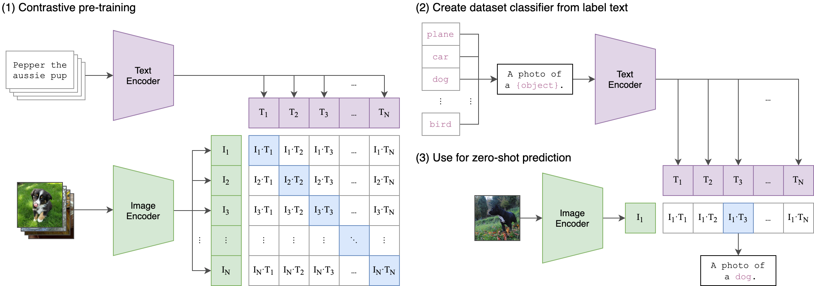
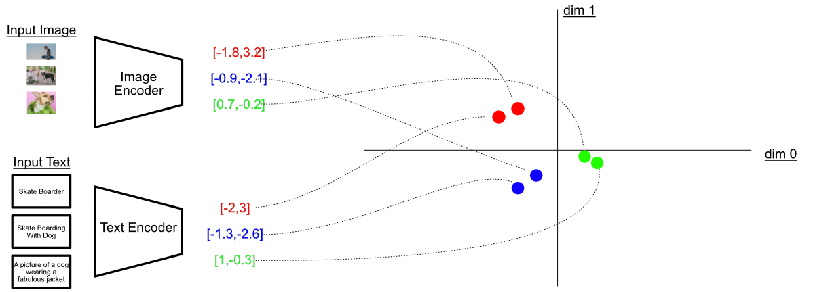
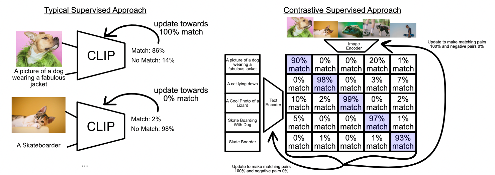

# CLIP from Scratch

A compact PyTorch implementation of **CLIP (Contrastive Language–Image Pre-training)**, following Radford et al. (2021). An image encoder and a text encoder are trained jointly so that matching image–caption pairs land close together in a shared embedding space, while mismatched pairs are pushed apart.

> **Scope:** This is a small-scale implementation for learning and experimentation, not a reproduction of OpenAI's original training run. Both encoders are trained from scratch on a small dataset (a Flickr8k subset), so results are not comparable to the published models.

## Architecture



CLIP is made of two independent encoders and two projection heads:

```
image ──► Vision Transformer ──► image projection ──► L2 norm ──┐
                                                                ├──► scaled cosine similarity ──► [B, B] logits
text  ──► Causal Text Transformer ──► text projection ──► L2 norm ┘
```

For a batch of `B` paired images and captions, the model returns two similarity matrices of shape `[B, B]` (image-to-text and text-to-image). The diagonal holds the matching pairs; every off-diagonal entry is a negative.

### Image encoder (Vision Transformer)

1. **Patch embedding:** the `3 × 224 × 224` image is split into `16 × 16` patches (14 × 14 = 196 patches), and each patch is linearly embedded to width `256`.
2. **CLS token:** a learnable class token is prepended, giving a sequence of 197 tokens.
3. **Positional embeddings:** learned position embeddings are added to the token sequence.
4. **Transformer blocks:** 6 pre-norm blocks, each with 8-head self-attention and an MLP.
5. **Output:** the final CLS representation is the image feature that goes to the projection head.

### Text encoder (causal Transformer)

1. **Tokenization:** captions are tokenized with the Hugging Face `openai/clip-vit-base-patch32` tokenizer and padded or truncated to a context length of `77`.
2. **Embeddings:** token embeddings plus learned positional embeddings, width `256`.
3. **Transformer blocks:** 6 blocks with 8 heads and a **causal attention mask**, so each token only attends to earlier tokens.
4. **Output:** one token's final representation (see the pooling note in the code) is the text feature that goes to the projection head.

### Projection heads and shared space

Each encoder is followed by its own linear projection into a shared **512-dimensional** embedding space. Embeddings are then **L2-normalized**, so the dot product between an image embedding and a text embedding is their cosine similarity.



The figure shows the idea in 2D: the image encoder and text encoder are different networks, but their outputs live in the same space. After training, an image and its matching caption (same color) end up close together, while unrelated pairs end up far apart.

### Similarity and temperature

Cosine similarities lie in `[-1, 1]`, which is too narrow for a sharp softmax. A learnable scalar `logit_scale` multiplies the similarities, acting as an inverse temperature (capped at `100` for stability):

```
logits_per_image = logit_scale * image_emb @ text_emb.T    # [B, B]
logits_per_text  = logits_per_image.T                      # [B, B]
```

## Training objective



A typical supervised setup (left) scores one image–text pair at a time and pushes it toward "match" or "no match". CLIP's contrastive setup (right) scores every image against every caption in the batch at once: the diagonal (highlighted) should be high and everything else low. The percentages in the figure are only illustrative; in practice the loss below is a softmax cross-entropy over each row and each column of the logits matrix.

CLIP uses a symmetric contrastive (InfoNCE-style) loss. With the correct match for item `i` at index `i`:

```
labels = arange(B)
loss = ( CrossEntropy(logits_per_image, labels)
       + CrossEntropy(logits_per_text,  labels) ) / 2
```

- **Image → text:** for each image, pick its caption out of the `B` captions in the batch.
- **Text → image:** for each caption, pick its image out of the `B` images in the batch.

Every other pair in the batch serves as a negative, so larger batches give a harder, more informative task.

## Configuration

| Component | Configuration |
|---|---|
| Image input | `3 × 224 × 224` |
| Image encoder | ViT, patch size `16`, width `256`, `6` blocks, `8` heads |
| Text encoder | Context length `77`, width `256`, `6` blocks, `8` heads, causal mask |
| Shared embedding | `512` dimensions |
| Tokenizer | `openai/clip-vit-base-patch32` (Hugging Face) |
| Loss | Symmetric contrastive cross-entropy |
| Optimizer | AdamW with decay / no-decay parameter groups |
| LR schedule | Linear warm-up, then cosine decay |
| Training data | Flickr8k subset, one random caption per image per step |

## Design notes

- **Weight decay groups:** parameters with fewer than two dimensions (biases, normalization scales, `logit_scale`) are excluded from weight decay.
- **Learnable temperature:** the similarity scale is trained along with the encoders instead of being a fixed hyperparameter.
- **Image-level splits:** train and validation are split by image, so captions of the same image never appear in both.

## Limitations

- Both encoders are trained from scratch, not pretrained.
- Model width (`256`) and depth (`6` blocks) are far smaller than the original CLIP models.
- Only validation loss is reported; retrieval metrics such as image-to-text and text-to-image Recall@K are not yet computed.
- Checkpoints store the model `state_dict`, so the model must be rebuilt with the matching configuration before loading weights.

## Reference

Radford, A. et al. (2021). *Learning Transferable Visual Models From Natural Language Supervision.* [arXiv:2103.00020](https://arxiv.org/abs/2103.00020)