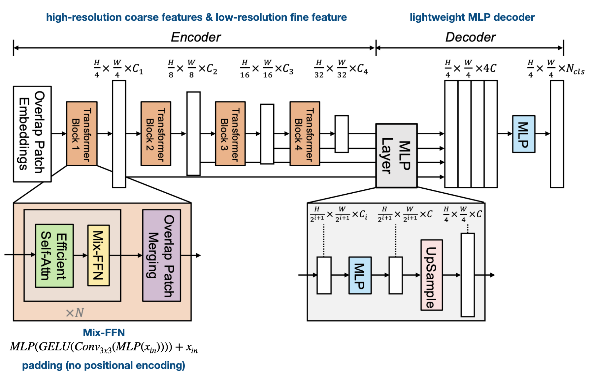
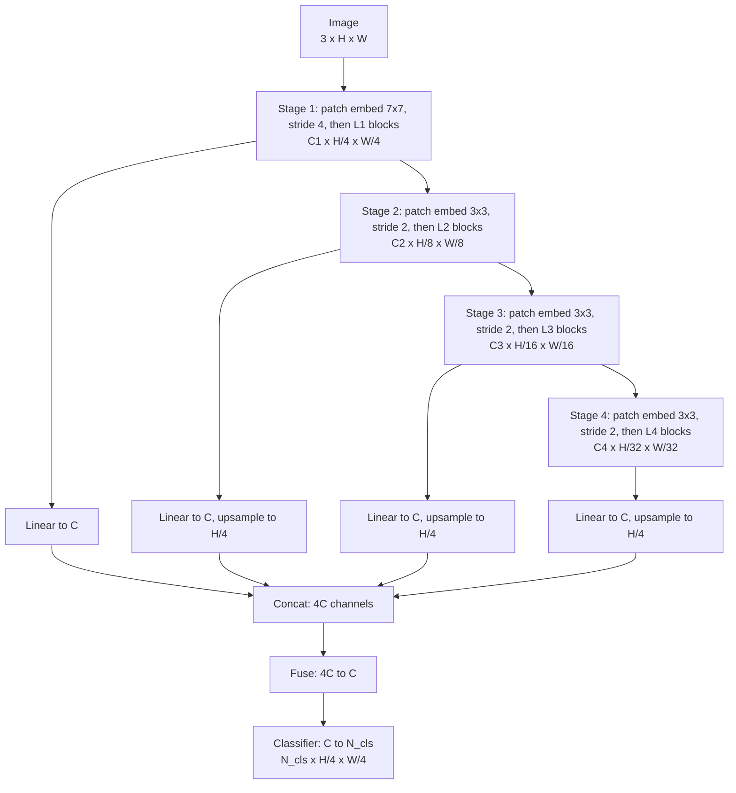
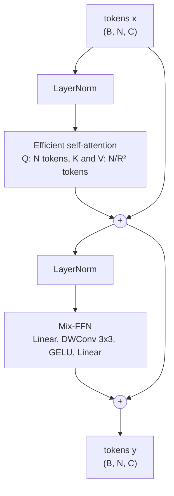

# SegFormer: Paper Walkthrough, Model Details and Training Pitfalls

A from-scratch PyTorch implementation of **SegFormer** (Xie et al., NeurIPS 2021, [arXiv 2105.15203](https://arxiv.org/abs/2105.15203)), plus a guide to the parts of the paper that are easy to misread.

Source tags used throughout:

- **paper**: stated in the paper.
- **official code**: taken from the official repository ([NVlabs/SegFormer](https://github.com/NVlabs/SegFormer)) as I recall it. Verify before relying on it.
- **impl**: an implementation choice the paper does not specify.

## Architecture

## Contents

1. [The idea in one page](#1-the-idea-in-one-page)
2. [Architecture at a glance](#2-architecture-at-a-glance)
3. [The model, component by component](#3-the-model-component-by-component)
4. [Tricky parts and inconsistencies](#4-tricky-parts-and-inconsistencies)
5. [Training](#5-training)
6. [Results reported in the paper](#6-results-reported-in-the-paper)
7. [Code map](#7-code-map)
8. [Verification checklist](#8-verification-checklist)

---

## 1. The idea in one page

Semantic segmentation labels every pixel. Earlier Transformer approaches (for example SETR) used a plain ViT, which has two problems for this task:

- It produces one feature map at 1/16 resolution, which is too coarse for fine boundaries.
- Self-attention costs $O(N^2)$ in the number of tokens, so working at higher resolution is expensive. Fixed positional embeddings also have to be interpolated when the test resolution differs from training.

SegFormer changes four things:

| Change | What it does |
|---|---|
| Hierarchical encoder (MiT) | Produces four feature maps at strides 4, 8, 16, 32 |
| Efficient self-attention | Shortens keys and values, cutting attention cost |
| Mix-FFN | A 3x3 depthwise convolution inside the FFN replaces positional encoding |
| All-MLP decoder | Fuses the four maps with only linear layers |

The decoder is deliberately tiny (about 0.4M parameters for B0). The paper argues the Transformer's deep stages already have a large receptive field, so the decoder does not need a context module such as ASPP.

---

## 2. Architecture at a glance

One Transformer block (pre-norm form from the official code):

### Shape trace for MiT-B0 at 512 x 512

| Step | Output shape |
|---|---|
| Input | $B \times 3 \times 512 \times 512$ |
| Stage 1 | $B \times 32 \times 128 \times 128$ (16,384 tokens) |
| Stage 2 | $B \times 64 \times 64 \times 64$ (4,096 tokens) |
| Stage 3 | $B \times 160 \times 32 \times 32$ (1,024 tokens) |
| Stage 4 | $B \times 256 \times 16 \times 16$ (256 tokens) |
| Decoder, after concat | $B \times 1024 \times 128 \times 128$ |
| Decoder, after fuse | $B \times 256 \times 128 \times 128$ |
| Logits | $B \times N_{cls} \times 128 \times 128$ |
| Upsampled logits (impl, not in the paper) | $B \times N_{cls} \times 512 \times 512$ |

---

## 3. The model, component by component

### 3.1 Overlapped patch embedding

Each stage starts by turning a feature map into tokens. ViT cuts non-overlapping 16x16 patches, so pixels on opposite sides of a patch border never share a patch. SegFormer uses a strided convolution with kernel larger than stride, so neighboring patches overlap.

| Stage | Kernel $K$ | Stride $S$ | Padding $P$ |
|---|---|---|---|
| 1 | 7 | 4 | 3 |
| 2 to 4 | 3 | 2 | 1 |

The output size follows

$$
H_{out} = \left\lfloor \frac{H + 2P - K}{S} \right\rfloor + 1
$$

With these settings the result is exactly $H/4$ for stage 1 and half the previous height afterwards, **when the sizes divide evenly**. If $H$ or $W$ is not divisible by 32, the floor silently drops edge rows and columns. Use sizes divisible by 32.

The embedding is: convolution, flatten the grid to a sequence, then **LayerNorm**. The LayerNorm is easy to forget, because the paper's text barely mentions it.

### 3.2 Efficient self-attention

Standard attention:

$$
\text{Attention}(Q,K,V)=\text{softmax}\!\left(\frac{QK^{\top}}{\sqrt{d_{head}}}\right)V
$$

$QK^{\top}$ is an $N \times N$ matrix. For stage 1 at 512 x 512, $N = 16384$, so one head holds about 268 million scores. SegFormer shortens only $K$ and $V$ (queries keep full length):

$$
\hat{K}=\text{Reshape}\!\left(\tfrac{N}{R},\, C\cdot R\right)(K),\qquad
K=\text{Linear}(C\cdot R,\; C)(\hat{K})
$$

and the same for $V$. The cost drops from $O(N^2)$ to $O(N^2/R)$.

**Tricky part 1: $R$ means two different things.** In the equation above, $R$ is the *sequence* reduction factor (64, 16, 4, 1 for the four stages). In the paper's Table 6, "reduction ratio" is the *spatial* ratio (8, 4, 2, 1). They are related by

$$
R_{seq} = R_{spatial}^{2}
$$

Implementations use the spatial ratio. In stage 1, $R_{spatial} = 8$ shrinks a 128 x 128 map to 16 x 16 = 256 key/value tokens.

**Tricky part 2: the "Reshape" is a 2D patch operation.** Read literally, reshaping the flattened sequence into groups of $R$ consecutive tokens would group a 1 x $R$ strip of one row (this is my reading of the equation). The official code instead uses a convolution with `kernel_size = stride = R_spatial` on the 2D map, followed by LayerNorm, then a linear layer that produces $K$ and $V$. That is a linear map on non-overlapping $R \times R$ patches, which is what the paper means.

At 512 x 512 the key/value length is 256 in every stage, because the spatial ratio shrinks at the same rate as the map:

| Stage | Queries $N$ | $R_{spatial}$ | K/V tokens | Heads x head dim | Score matrix per head |
|---|---|---|---|---|---|
| 1 | 16,384 | 8 | 256 | 1 x 32 | 16,384 x 256 |
| 2 | 4,096 | 4 | 256 | 2 x 32 | 4,096 x 256 |
| 3 | 1,024 | 2 | 256 | 5 x 32 | 1,024 x 256 |
| 4 | 256 | 1 | 256 | 8 x 32 | 256 x 256 |

For B0 the head dimension is 32 in every stage, so $\sqrt{d_{head}}$ is the same everywhere. Note also that when $R_{spatial}=1$ (stage 4) there is no reduction convolution and no extra LayerNorm.

### 3.3 Mix-FFN

$$
x_{out}=\text{MLP}\Big(\text{GELU}\big(\text{Conv}_{3\times 3}(\text{MLP}(x_{in}))\big)\Big)+x_{in}
$$

In order: a linear layer expands $C$ to $E\cdot C$; the sequence is reshaped to a $B \times EC \times H \times W$ map; a **depthwise** 3x3 convolution is applied (`groups = E*C`, padding 1); GELU; flatten back; a linear layer projects to $C$.

**Why there is no positional encoding.** The convolution zero-pads its input, so positions near the border see different values from interior positions. The paper cites earlier work showing that a network can read absolute position from this, and argues a 3x3 convolution provides enough of it. The supporting evidence is a single Cityscapes ablation (paper Table 1c):

| Test resolution | With positional encoding | With Mix-FFN |
|---|---|---|
| 768 x 768 | 77.3 | 80.5 |
| 1024 x 2048 | 74.0 | 79.8 |
| Drop | -3.3 | -0.7 |

Treat this as good evidence that Mix-FFN is more robust to a change in test resolution, and weaker evidence that the convolution recovers *absolute* position.

### 3.4 Block and stage assembly

**Tricky part 3: where the residual and the norms go.** The paper's Mix-FFN equation includes `+ x_in`, and the text does not say where LayerNorm sits. The official code is pre-norm:

$$
x' = x + \text{Attention}(\text{LN}(x)),\qquad
y = x' + \text{MixFFN}(\text{LN}(x'))
$$

Here MixFFN means the MLP, convolution, GELU, MLP path **without** its own skip term, since the skip is added in the second equation. If you copy the paper's equation literally *and* add a block-level residual, the skip is counted twice.

Each stage is: patch embedding, $L_i$ blocks, then a final LayerNorm, then a reshape back to $B \times C_i \times H_i \times W_i$. That map is the stage output $F_i$ and the input to the next stage's patch embedding.

### 3.5 All-MLP decoder

$$
\begin{aligned}
F'_i &= \text{Linear}(C_i, C)(F_i), &&\forall i \\
F''_i &= \text{Upsample}\!\left(\tfrac{H}{4}\times\tfrac{W}{4}\right)(F'_i), &&\forall i \\
F &= \text{Linear}(4C, C)\big(\text{Concat}(F''_1,F''_2,F''_3,F''_4)\big) \\
M &= \text{Linear}(C, N_{cls})(F)
\end{aligned}
$$

The paper's printed version uses the same hat symbol for the first two results and writes the upsample target as $W/4 \times W/4$, which is a typo for $H/4 \times W/4$. They are renamed $F'$ and $F''$ here.

A "Linear" applied at every pixel is a 1x1 convolution in code. The decoder width $C$ is 256 for B0 and B1 and 768 for B2 to B5.

**Parameter check for B0 with 19 classes and $C=256$:** projections $131{,}072 + 1{,}024$ biases, fuse $262{,}144 + 512$ (BatchNorm), classifier $256 \cdot 19 + 19 = 4{,}883$. Total about **0.40M**, which matches the paper's 0.4M decoder for B0.

**Why a decoder this simple works** (paper Table 1d): the same MLP decoder on CNN encoders reaches 34.7 (ResNet-50), 38.7 (ResNet-101) and 39.8 (ResNeXt-101) mIoU on ADE20K, against 45.4 for MiT-B2 using all four stages. Using only stage 4 of MiT-B2 gives 43.1, so the early stages still contribute. The receptive-field explanation in the paper is qualitative (visualizations), not a measured proof.

### 3.6 Variants

All variants use 1, 2, 5, 8 heads and spatial reduction ratios 8, 4, 2, 1.

| Model | Channels $C_i$ | Blocks $L_i$ | Decoder width $C$ |
|---|---|---|---|
| MiT-B0 | 32, 64, 160, 256 | 2, 2, 2, 2 | 256 |
| MiT-B1 | 64, 128, 320, 512 | 2, 2, 2, 2 | 256 |
| MiT-B2 | 64, 128, 320, 512 | 3, 4, 6, 3 | 768 |
| MiT-B3 | 64, 128, 320, 512 | 3, 4, 18, 3 | 768 |
| MiT-B4 | 64, 128, 320, 512 | 3, 8, 27, 3 | 768 |
| MiT-B5 | 64, 128, 320, 512 | 3, 6, 40, 3 | 768 |

B0 has 3.4M encoder and 0.4M decoder parameters. B5 has 81.4M encoder and 3.3M decoder parameters.

---

## 4. Tricky parts and inconsistencies

| # | Issue | What to do |
|---|---|---|
| 1 | $R$ is the sequence ratio in Equation 2 but the spatial ratio in Table 6 | Use the spatial ratio $[8,4,2,1]$ in code |
| 2 | The key/value "Reshape" reads like a 1D grouping | Use a conv with kernel = stride = $R_{spatial}$ on the 2D map, then LayerNorm |
| 3 | Residual inside the Mix-FFN equation; LayerNorm placement not stated | Use pre-norm blocks with one skip per sublayer; add a LayerNorm after each stage |
| 4 | Decoder equation has a $W/4 \times W/4$ typo and reuses one symbol twice | Upsample to $H/4 \times W/4$; keep the intermediates separate |
| 5 | Paper says the fuse layer is a Linear | Official code uses 1x1 conv + BatchNorm + ReLU, plus Dropout2d(0.1) before the classifier (official code) |
| 6 | Concat order: paper lists stage 1 to 4 | Official code concatenates stage 4 first. Irrelevant for a random head, matters only when loading a trained SegFormer head |
| 7 | B0 FFN expansion: Table 6 lists 8, 8, 4, 4 | The pretrained MiT-B0 checkpoint uses 4 in all stages, to my knowledge. Read the `fc1` weight shape from the checkpoint |
| 8 | Output is at 1/4 resolution | The bilinear x4 upsample before the loss is an implementation step, not in the paper |
| 9 | Loss, weight decay, warmup, stochastic depth are not described | Use cross-entropy with `ignore_index`; the others come from the official configs |
| 10 | B5 ADE20K is quoted as 51.0 in one place and 51.8 in another | 51.0 is single-scale, 51.8 is multi-scale |
| 11 | B0 total parameters appear as 3.7M and 3.8M | Rounding of 3.4M + 0.4M; use per-part counts for verification |

---

## 5. Training

### 5.1 The recipe

| Setting | Value | Source |
|---|---|---|
| Encoder initialization | ImageNet-1K pretrained MiT | paper |
| Decoder initialization | Random | paper |
| Optimizer | AdamW | paper |
| Initial learning rate | $6 \times 10^{-5}$ | paper |
| Schedule | Polynomial decay, power 1.0 | paper |
| Iterations | 160K (ADE20K, Cityscapes), 80K (COCO-Stuff), 40K (ablations) | paper |
| Batch size | 16 (ADE20K, COCO-Stuff), 8 (Cityscapes) | paper |
| Crop size | 512 x 512 (ADE20K, COCO-Stuff), 1024 x 1024 (Cityscapes), 640 x 640 (B5 on ADE20K) | paper |
| Augmentation | Random resize 0.5 to 2.0, random horizontal flip, random crop | paper |
| Auxiliary loss, OHEM, class-balancing | None | paper |
| Weight decay | 0.01 | official code |
| Decoder learning rate | 10x the base rate | official code |
| Warmup | Linear, 1500 iterations | official code |
| Stochastic depth | 0.1 | official code |

The poly schedule is

$$
\text{lr}(t)=\text{lr}_0\left(1-\frac{t}{T}\right)^{p},\qquad p = 1.0
$$

so with power 1.0 it is simply a linear decay to zero over $T$ iterations.

### 5.2 Pretraining matters

The encoder is pretrained on ImageNet-1K (the paper reports 70.5% top-1 for B0 and 83.8% for B5). Transformers are data hungry, so **training the encoder from scratch on a small segmentation dataset will score far below the paper**. Load `nvidia/mit-b0` into your encoder, then check that your outputs match the HuggingFace model on the same input (see the checklist). If your module names differ from the checkpoint, you need a key-mapping step.

### 5.3 Loss

The paper does not write the loss. It is per-pixel cross-entropy over labeled pixels:

$$
\mathcal{L}=-\frac{1}{|\Omega|}\sum_{p\in\Omega}\log\frac{\exp\big(z_p[y_p]\big)}{\sum_{c}\exp\big(z_p[c]\big)}
$$

where $\Omega$ is the set of labeled pixels, $z_p$ the logits at pixel $p$ and $y_p$ the true class. Pixels with the ignore label (255 in Cityscapes and Pascal VOC) are excluded from $\Omega$.

Practical points:

- Upsample the logits to the label size **before** the loss (impl). Downsampling labels to 1/4 with nearest neighbor loses thin structures.
- Use the same `ignore_index` in the loss and in the metric.

### 5.4 Parameter groups (official code)

Three groups are worth separating:

1. Encoder weights: base learning rate, weight decay 0.01.
2. Normalization layers and the Mix-FFN depthwise convolution: no weight decay.
3. Decoder head: learning rate multiplied by 10.

The head gets a larger rate because it starts from random weights while the encoder is only being fine-tuned.

### 5.5 Data pipeline

- Scale first, then crop. Pad with 0 for images and with **255 for labels**, so padded pixels never count in the loss.
- Resize images bilinearly and **masks with nearest neighbor**. Interpolating mask values creates invalid classes.
- Normalize with ImageNet mean and standard deviation (impl; the paper does not say, but the encoder was pretrained that way).

### 5.6 Evaluation

The metric is mean intersection over union:

$$
\text{IoU}_c=\frac{TP_c}{TP_c+FP_c+FN_c},\qquad
\text{mIoU}=\frac{1}{N_{cls}}\sum_{c}\text{IoU}_c
$$

Common mistake: computing IoU per image and averaging. Accumulate one confusion matrix over the **whole validation set**, then compute per-class IoU from it. Classes absent from the data should be excluded from the mean (or reported as NaN), not counted as 0.

Paper settings:

- ADE20K and COCO-Stuff: rescale the short side to the crop size, keep aspect ratio.
- Cityscapes: sliding window with 1024 x 1024 crops (stride 768 in the official code).
- Single-scale and multi-scale numbers are both reported, so check which one a table quotes.

### 5.7 Adapting to a small, low-resolution dataset

This repository targets the Kaggle Cityscapes variant with **96 x 256** images. I could only read the dataset description, not its files, so the folder layout and mask encoding need checking.

| Paper setting | Adaptation |
|---|---|
| 1024 x 1024 crops, sliding-window inference | Whole-image inference at 96 x 256 |
| 160K iterations | 40K as a starting point |
| Full-resolution detail | Stage maps shrink to 24x64, 12x32, 6x16, 3x8 |

Both sizes divide by 32, so every stage works. Key/value length is 3 x 8 = 24 in all stages. Expect mIoU well below the paper's Cityscapes numbers, because the 1/4-resolution logits are only 24 x 64 and small objects disappear.

---

## 6. Results reported in the paper

mIoU, single-scale / multi-scale where both are given.

| Model | Params (encoder + decoder) | ADE20K | Cityscapes (val) |
|---|---|---|---|
| MiT-B0 | 3.4M + 0.4M | 37.4 / 38.0 | 76.2 / 78.1 |
| MiT-B5 | 81.4M + 3.3M | 51.0 / 51.8 | 82.4 / 84.0 |

Other claims: B0 reaches 37.4 mIoU on ADE20K at about 50 FPS with 8.4 GFLOPs; B5 beats SETR (50.2) on ADE20K with a quarter of the parameters; B5 reaches 46.7 on COCO-Stuff; and robustness on Cityscapes-C is much higher than DeepLabv3+ variants (for example 57.8 under Gaussian noise against single digits to high teens). FPS figures depend on the authors' hardware, and baselines use different pretraining data, so cross-method comparisons are not exact.

---

## 7. Code map

| Paper component | Class in this repository |
|---|---|
| Overlapped patch embedding | `OverlapPatchEmbedding` |
| Efficient self-attention (Equations 1 and 2) | `EfficientSelfAttention` |
| Mix-FFN (Equation 3) | `MixFFN` |
| Transformer block | `MiTTransformerBlock` |
| Mix Transformer encoder (four stages) | `MixVisionTransformer` in `mit_encoder.py` |
| All-MLP decoder (Equation 4) | `SegFormerHead` in `segformer.py` |
| Full model | `SegFormer` in `segformer.py` |
| All hyperparameters | `config.yaml` |

---

## 8. Verification checklist

1. Print the shape after every stage and compare with the shape trace above.
2. Count parameters per part. MiT-B0 should be about 3.3M to 3.4M for the encoder and about 0.4M for the decoder.
3. Run a non-square input (for example 384 x 640). With no positional encoding the model should accept it unchanged.
4. Load `nvidia/mit-b0` into your encoder and compare outputs with the HuggingFace model on the same input. A mismatch beyond numerical noise usually means a LayerNorm placement or reshape error.
5. Overfit a batch of about ten images. A correct model drives the loss close to zero within a few hundred steps.
6. Check that the loss and the metric both ignore label 255, and that mIoU comes from a dataset-level confusion matrix.

---

## Reference

Enze Xie, Wenhai Wang, Zhiding Yu, Anima Anandkumar, Jose M. Alvarez, Ping Luo. *SegFormer: Simple and Efficient Design for Semantic Segmentation with Transformers.* NeurIPS 2021. [arXiv 2105.15203](https://arxiv.org/abs/2105.15203). Official code: [NVlabs/SegFormer](https://github.com/NVlabs/SegFormer).