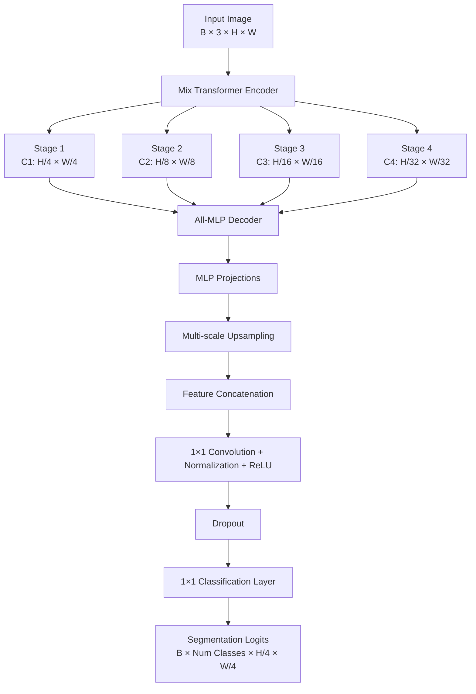
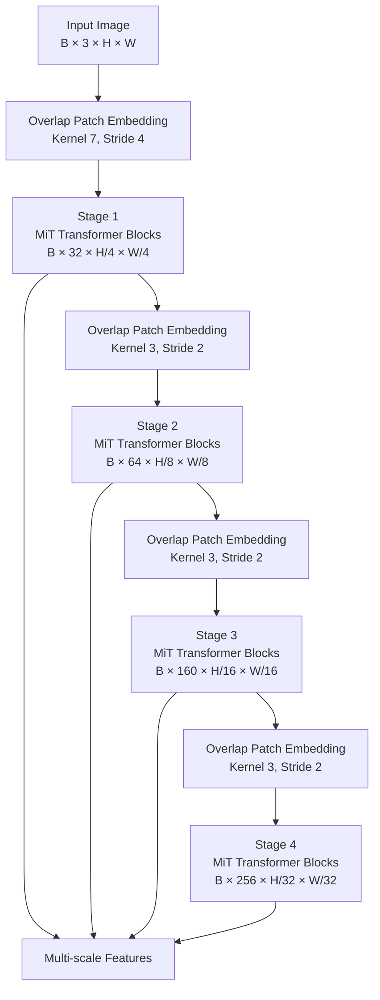
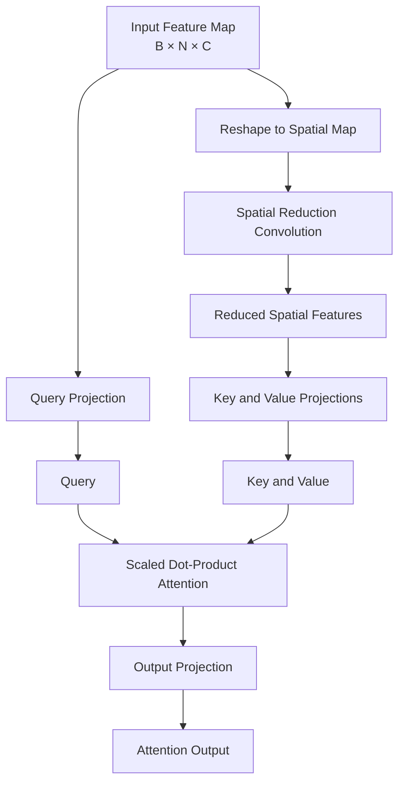
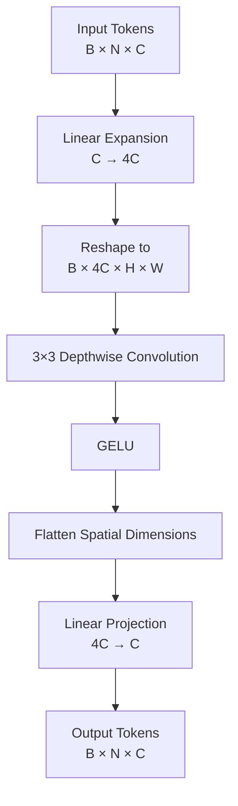
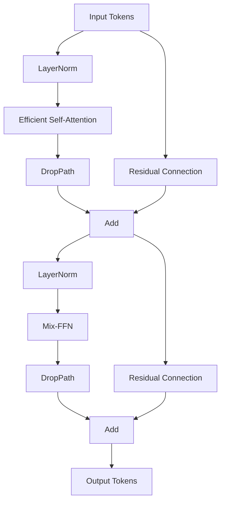
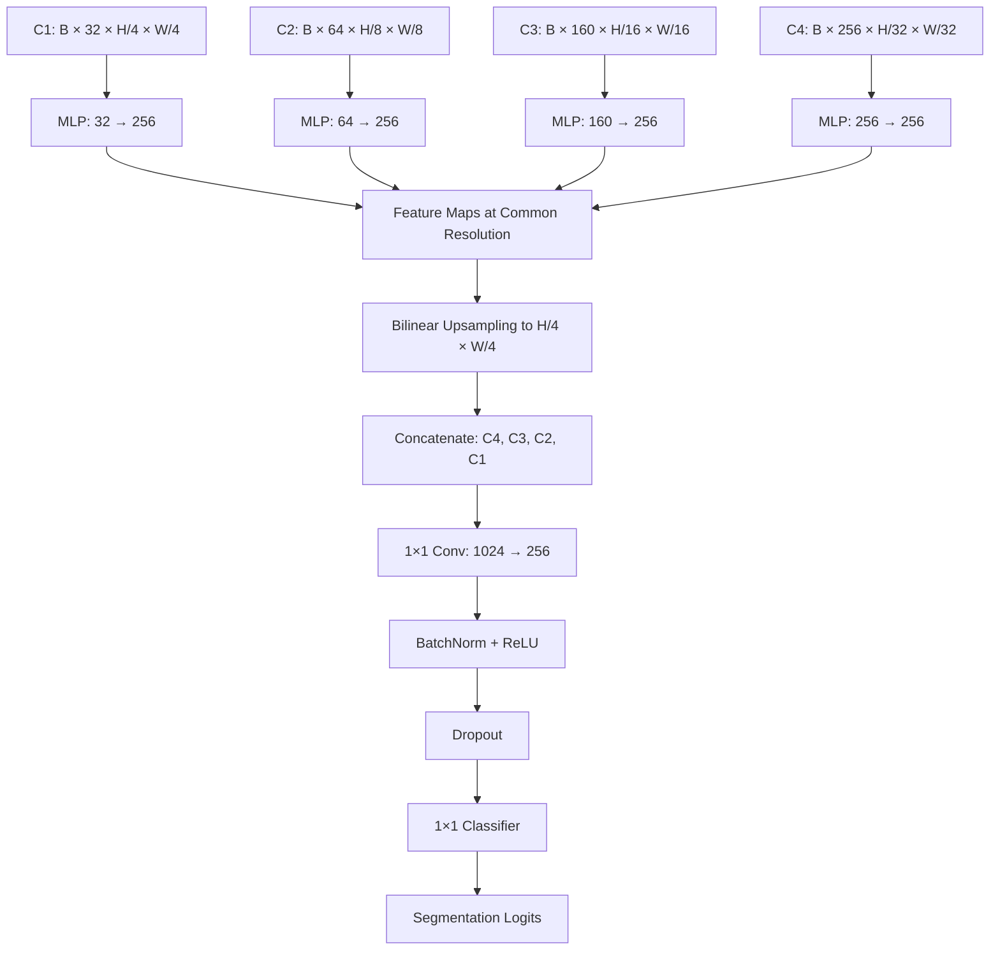
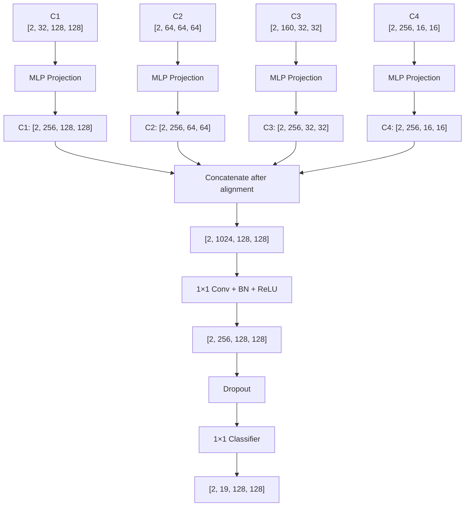

# SegFormer — Semantic Segmentation with MiT and an All-MLP Decoder

A PyTorch implementation of **SegFormer**, a Transformer-based architecture for semantic segmentation. The model combines a hierarchical Transformer encoder, called Mix Transformer (MiT), with a lightweight All-MLP decoder to extract and combine multi-scale visual features.

The implementation focuses on understanding the architecture, reproducing its main components, and making the tensor transformations and design decisions explicit.

---

## Table of Contents

- [1. Overview](#1-overview)
- [2. Architecture](#2-architecture)
- [3. Mix Transformer Encoder](#3-mix-transformer-encoder)
  - [3.1 Overlapping Patch Embedding](#31-overlapping-patch-embedding)
  - [3.2 Efficient Self-Attention](#32-efficient-self-attention)
  - [3.3 Spatial Reduction Attention](#33-spatial-reduction-attention)
  - [3.4 Mix-FFN](#34-mix-ffn)
  - [3.5 Transformer Block](#35-transformer-block)
  - [3.6 Hierarchical Encoder Stages](#36-hierarchical-encoder-stages)
- [4. All-MLP Decoder](#4-all-mlp-decoder)
  - [4.1 Multi-Scale Feature Projection](#41-multi-scale-feature-projection)
  - [4.2 Tensor Flattening and Reshaping](#42-tensor-flattening-and-reshaping)
  - [4.3 Multi-Scale Feature Alignment](#43-multi-scale-feature-alignment)
  - [4.4 Feature Concatenation](#44-feature-concatenation)
  - [4.5 Feature Fusion](#45-feature-fusion)
  - [4.6 Pixel-Level Classification](#46-pixel-level-classification)
- [5. Complete Tensor Flow](#5-complete-tensor-flow)
- [6. Important Implementation Details](#6-important-implementation-details)
- [7. Model Output](#7-model-output)
- [8. References](#8-references)

---

## 1. Overview

Traditional CNN-based segmentation architectures often rely on convolutional feature extractors and complex decoders to combine multi-scale information.

SegFormer introduces a different approach:

- A hierarchical Transformer encoder extracts features at multiple spatial resolutions.
- Efficient self-attention captures long-range relationships.
- A lightweight All-MLP decoder combines the encoder's multi-scale features.
- The architecture avoids positional embeddings and uses a hierarchical feature representation.

The model has two main components:

1. **MiT Encoder:** Extracts hierarchical representations from the input image.
2. **All-MLP Decoder:** Combines multi-scale features and generates segmentation logits.

The central idea is to combine the global contextual representation of Transformers with spatial information from multiple feature scales.

## 2. Architecture

### High-level architecture



### Architecture configuration

The following example uses the channel dimensions associated with MiT-B0:

| Component | Configuration |
|---|---|
| Encoder | Mix Transformer |
| Number of stages | 4 |
| Stage channels | `[32, 64, 160, 256]` |
| Stage strides | `[4, 8, 16, 32]` |
| Decoder | All-MLP |
| Decoder embedding dimension | 256 |
| Decoder fusion | 1×1 convolution |
| Classification | 1×1 convolution |

The encoder configuration, including the number of Transformer blocks and attention heads per stage, depends on the MiT variant.

---

## 3. Mix Transformer Encoder

The Mix Transformer (MiT) is the feature extraction component of SegFormer.

Unlike a conventional Vision Transformer that typically divides an image into fixed-size patches and maintains one spatial resolution, MiT builds a hierarchical representation.

It progressively reduces spatial resolution while increasing the number of channels.

### Encoder structure



Each stage contains:

1. Overlapping Patch Embedding.
2. Multiple Transformer blocks.
3. Normalization of the stage output.

The four stage outputs are passed to the decoder.

### 3.1 Overlapping Patch Embedding

Patch embedding converts an image or feature map into a sequence of tokens.

MiT uses convolutional patch embedding rather than non-overlapping patch extraction.

A typical implementation:

```python
self.proj = nn.Conv2d(
    in_channels,
    embed_dim,
    kernel_size=patch_size,
    stride=stride,
    padding=padding,
)
```

For the first stage:

```python
kernel_size = 7
stride = 4
padding = 3
```

For subsequent stages:

```python
kernel_size = 3
stride = 2
padding = 1
```

**Why overlapping patches?**

With overlapping patches, neighboring feature regions share some input information.

This helps preserve local spatial relationships during the transition from one stage to another.

For example, given a 512×512 input:

```text
Input:
[B, 3, 512, 512]

After Stage 1 Patch Embedding:
[B, 32, 128, 128]
```

The spatial dimensions are reduced by a factor of four, while the channel dimension becomes 32.

**Important:** Patch embedding performs both spatial downsampling and channel projection.

### 3.2 Efficient Self-Attention

Self-attention allows each token to interact with other tokens and capture contextual relationships.

The standard attention operation is:

$$
Attention(Q,K,V)=
Softmax\left(\frac{QK^T}{\sqrt{d_k}}\right)V
$$

Where:

- Q: Query representations.
- K: Key representations.
- V: Value representations.
- $d_k$: Dimension of each attention head.

In a standard Transformer, attention is calculated between all spatial tokens.

For an input containing $N=H\times W$ tokens, the attention matrix has shape:

$$
[N,N]
$$

This becomes expensive for high-resolution feature maps.

MiT addresses this problem using Spatial Reduction Attention.

### 3.3 Spatial Reduction Attention

Spatial Reduction Attention (SRA) reduces the spatial dimensions of the key and value representations before computing attention.

The query retains the original spatial resolution, while keys and values are computed from a reduced feature map.



A common implementation:

```python
if sr_ratio > 1:
    self.sr = nn.Conv2d(
        dim,
        dim,
        kernel_size=sr_ratio,
        stride=sr_ratio,
    )
    self.norm = nn.LayerNorm(dim)
```

The reduction ratio determines how aggressively the spatial dimensions of K and V are reduced.

For example, if:

```text
Input feature map: [B, 64, 64, 64]
sr_ratio = 8
```

The spatial reduction convolution produces:

```text
[B, 64, 8, 8]
```

The number of spatial tokens changes from:

$$
64\times64=4096
$$

to:

$$
8\times8=64
$$

This significantly reduces the attention computation.

**Important distinction:** SRA does not reduce the spatial resolution of the final feature map. Only the key/value representations are spatially reduced for attention. The attention output retains the query's token count.

### 3.4 Mix-FFN

The Feed-Forward Network (FFN) processes the token representations after attention.

MiT uses a modified FFN called Mix-FFN.

Its main operations are:

1. Linear expansion.
2. Reshape into a spatial feature map.
3. Depthwise convolution.
4. GELU activation.
5. Linear projection.



The depthwise convolution introduces local spatial interactions.

This is important because flattening a feature map into a sequence does not itself preserve explicit spatial neighborhood structure.

The convolution allows the FFN to incorporate local spatial information.

### 3.5 Transformer Block

A MiT Transformer block combines attention and the Mix-FFN.



Mathematically:

$$
X_1=X+DropPath(Attention(LN(X)))
$$

$$
X_2=X_1+DropPath(FFN(LN(X_1)))
$$

The two residual connections help preserve information and support optimization in deeper networks.

**DropPath versus Dropout**

These operations are not interchangeable.

- Dropout randomly zeros individual activations.
- DropPath randomly drops the residual branch for a sample during training.

A typical stochastic-depth schedule:

```python
dpr = torch.linspace(
    0,
    drop_path_rate,
    sum(depths),
).tolist()
```

This generates different DropPath probabilities for Transformer blocks across the encoder.

The probability generally increases progressively from earlier blocks to later blocks.

### 3.6 Hierarchical Encoder Stages

The encoder has four stages.

For a 512×512 input and MiT-B0 channel dimensions:

| Stage | Spatial resolution | Channels | Example tensor shape |
|---|---:|---:|---|
| Stage 1 | 128×128 | 32 | `[B, 32, 128, 128]` |
| Stage 2 | 64×64 | 64 | `[B, 64, 64, 64]` |
| Stage 3 | 32×32 | 160 | `[B, 160, 32, 32]` |
| Stage 4 | 16×16 | 256 | `[B, 256, 16, 16]` |

The encoder returns all four feature maps rather than only the final one.

This is essential because the decoder needs both high-resolution spatial information and lower-resolution semantic information.

---

## 4. All-MLP Decoder

The SegFormer decoder is deliberately lightweight compared with many traditional segmentation decoders.

It does not use a complicated decoder hierarchy or a stack of large convolutional blocks.

Instead, it uses MLP projections to standardize the channel dimensions of all four encoder features.

The decoder performs five main operations:

1. Project each stage to a common embedding dimension.
2. Restore the spatial representation.
3. Upsample all features to the first stage's resolution.
4. Concatenate and fuse the features.
5. Generate per-pixel class logits.

### Decoder architecture



### 4.1 Multi-Scale Feature Projection

The encoder produces four feature maps with different channel dimensions.

For example:

```text
C1: [B, 32, 128, 128]
C2: [B, 64, 64, 64]
C3: [B, 160, 32, 32]
C4: [B, 256, 16, 16]
```

The decoder projects every stage into the same embedding dimension.

For an embedding dimension of 256:

```python
self.linear_c1 = MLP(32, 256)
self.linear_c2 = MLP(64, 256)
self.linear_c3 = MLP(160, 256)
self.linear_c4 = MLP(256, 256)
```

Each projection has independent learnable parameters.

The purpose is to make the channel dimensions compatible for concatenation.

**Important:** Projection changes the number of channels, not the spatial resolution.

### 4.2 Tensor Flattening and Reshaping

The original NVIDIA implementation uses an MLP similar to:

```python
class MLP(nn.Module):

    def __init__(self, input_dim, embed_dim):
        super().__init__()
        self.proj = nn.Linear(input_dim, embed_dim)

    def forward(self, x):
        x = x.flatten(2).transpose(1, 2)
        x = self.proj(x)
        return x
```

Consider C1:

```text
Input:
[B, 32, 128, 128]
```

First:

```python
x = x.flatten(2)
```

Combines height and width:

```text
[B, 32, 16384]
```

Because:

$$
128\times128=16384
$$

Then:

```python
x = x.transpose(1, 2)
```

Produces:

```text
[B, 16384, 32]
```

Now each spatial position is represented by a 32-dimensional vector.

The MLP projects each vector:

```python
x = self.proj(x)
```

Result:

```text
[B, 16384, 256]
```

The same linear transformation is independently applied to each spatial position.

#### Why use nn.Linear instead of nn.Conv2d?

A 1×1 convolution and a linear layer applied to the channel dimension perform mathematically equivalent projections when their weights and biases correspond.

For a 1×1 convolution:

$$
Y_{b,d,h,w}=
\sum_c W_{d,c}X_{b,c,h,w}+b_d
$$

For a linear projection:

$$
Y_{b,h,w,d}=
\sum_c W_{d,c}X_{b,h,w,c}+b_d
$$

The difference is primarily tensor layout and implementation style.

The original implementation uses `nn.Linear` to express the MLP projections directly.

### 4.3 Restoring Spatial Dimensions

After the MLP, the tensor has shape:

```text
[B, H × W, embed_dim]
```

The decoder needs a feature map in channel-first format:

```text
[B, embed_dim, H, W]
```

The original implementation performs:

```python
x = x.permute(0, 2, 1).reshape(
    n,
    -1,
    H,
    W,
)
```

For C1:

```text
[B, 16384, 256]
        ↓ transpose
[B, 256, 16384]
        ↓ reshape
[B, 256, 128, 128]
```

This operation restores the explicit height and width dimensions.

It does not change the number of spatial positions or the learned feature values.

### 4.4 Multi-Scale Feature Alignment

After projection and reshaping:

```text
C1: [B, 256, 128, 128]
C2: [B, 256, 64, 64]
C3: [B, 256, 32, 32]
C4: [B, 256, 16, 16]
```

The feature maps have equal channel dimensions but different spatial resolutions.

They must be aligned before concatenation.

The decoder uses bilinear interpolation:

```python
c2 = F.interpolate(
    c2,
    size=c1.shape[2:],
    mode="bilinear",
    align_corners=False,
)
```

The same operation is applied to C3 and C4.

After resizing:

```text
C1: [B, 256, 128, 128]
C2: [B, 256, 128, 128]
C3: [B, 256, 128, 128]
C4: [B, 256, 128, 128]
```

**Tricky detail:**

Upsampling does not recover information discarded during encoder downsampling. It interpolates existing feature values onto a larger spatial grid.

The benefit is that features from different encoder stages can now be combined at a common resolution.

### 4.5 Feature Concatenation

The original NVIDIA implementation concatenates the features in reverse stage order:

```python
x = torch.cat([c4, c3, c2, c1], dim=1)
```

Why `dim=1`?

Because PyTorch uses channel-first tensors:

```text
[B, C, H, W]
```

Dimension 1 represents the channels.

The resulting tensor is:

```text
[B, 1024, 128, 128]
```

Because:

$$
256+256+256+256=1024
$$

The concatenation places the feature channels alongside one another. It does not add or average them.

At this point, the tensor contains information from all four encoder stages.

**Tricky detail: Feature ordering**

The order `[C4, C3, C2, C1]` follows the original NVIDIA implementation.

Changing the order does not prevent training from scratch, because the fusion layer can learn a different mapping. However, it changes the relationship between the trained fusion weights and the feature channels.

Therefore, preserve the original order when reproducing the original implementation or loading compatible trained weights.

### 4.6 Feature Fusion

The concatenated features are passed through a 1×1 convolution:

```python
self.linear_fuse = nn.Sequential(
    nn.Conv2d(
        1024,
        256,
        kernel_size=1,
        bias=False,
    ),
    nn.BatchNorm2d(256),
    nn.ReLU(inplace=True),
)
```

The operation reduces the channels:

```text
[B, 1024, 128, 128]
        ↓
[B, 256, 128, 128]
```

The 1×1 convolution learns how to combine the information from all four stages.

Unlike concatenation, which only places channels together, fusion learns a weighted combination of those channels.

The remaining operations are:

- BatchNorm: normalizes the fused feature channels.
- ReLU: introduces non-linearity.

### 4.7 Pixel-Level Classification

After feature fusion, dropout is applied:

```python
self.dropout = nn.Dropout2d(0.1)
```

Then a final 1×1 convolution generates the segmentation logits:

```python
self.linear_pred = nn.Conv2d(
    256,
    num_classes,
    kernel_size=1,
)
```

For a dataset with 19 classes:

```text
Input:
[B, 256, 128, 128]

Output:
[B, 19, 128, 128]
```

Each output channel corresponds to one segmentation class.

At each spatial position, the model produces one logit per class.

The predicted class can be obtained using:

```python
prediction = logits.argmax(dim=1)
```

This produces:

```text
[B, 128, 128]
```

The result is a semantic segmentation map containing the predicted class index at every spatial position.

---

## 5. Complete Tensor Flow

Consider an input image of size 512×512, batch size 2, and 19 segmentation classes.

### Encoder outputs

| Stage | Tensor shape |
|---|---|
| Input | `[2, 3, 512, 512]` |
| C1 | `[2, 32, 128, 128]` |
| C2 | `[2, 64, 64, 64]` |
| C3 | `[2, 160, 32, 32]` |
| C4 | `[2, 256, 16, 16]` |

### Decoder transformations

| Operation | Result |
|---|---|
| C1 projection | `[2, 256, 128, 128]` |
| C2 projection | `[2, 256, 64, 64]` |
| C3 projection | `[2, 256, 32, 32]` |
| C4 projection | `[2, 256, 16, 16]` |
| Upsampling | Four maps at 128×128 |
| Concatenation | `[2, 1024, 128, 128]` |
| Fusion | `[2, 256, 128, 128]` |
| Dropout | `[2, 256, 128, 128]` |
| Classification | `[2, 19, 128, 128]` |

### Complete decoder flow



---

## 6. Important Implementation Details

This section highlights details that are easy to overlook when implementing SegFormer from scratch.

### 6.1 Tensor layout

PyTorch convolution layers expect:

```text
[B, C, H, W]
```

The MLP projection operates on the last dimension:

```text
[..., input_dim]
```

Therefore, the decoder must rearrange the tensor before and after applying the MLP.

Incorrect dimension ordering can cause shape errors or apply the projection to the wrong dimension.

### 6.2 Flattening does not remove spatial information

This operation:

```python
x.flatten(2).transpose(1, 2)
```

changes the tensor representation from a spatial feature map into a sequence of feature vectors.

It does not discard feature values.

However, the sequence no longer explicitly represents height and width as separate dimensions. This is why the original decoder restores the spatial dimensions before interpolation and concatenation.

### 6.3 Linear projection versus 1×1 convolution

These operations can implement equivalent channel-wise transformations:

```python
nn.Linear(in_channels, embed_dim)
```

and:

```python
nn.Conv2d(
    in_channels,
    embed_dim,
    kernel_size=1,
)
```

The original NVIDIA decoder uses linear projections for its stage-specific MLPs.

The fusion operation, on the other hand, uses a 1×1 convolution.

### 6.4 Interpolation versus learned upsampling

The decoder uses bilinear interpolation rather than transposed convolutions for multi-scale feature alignment.

This keeps the alignment operation parameter-free.

The subsequent fusion convolution learns how to combine the aligned feature representations.

### 6.5 Dropout versus DropPath

These are used in different parts of the architecture.

| Operation | Location | Purpose |
|---|---|---|
| DropPath | Transformer blocks | Stochastic depth on residual branches |
| Dropout2d | Decoder | Regularization by dropping feature channels |

They should not be confused or substituted without understanding the intended behavior.

### 6.6 Decoder output resolution

The decoder produces logits at 1/4 of the original input resolution.

For an input of 512×512:

```text
Decoder output: 128×128
```

To compare predictions with a full-resolution ground-truth segmentation mask, the logits are commonly upsampled:

```python
logits = F.interpolate(
    logits,
    size=target.shape[-2:],
    mode="bilinear",
    align_corners=False,
)
```

The loss is then calculated using the resized logits and the target mask.

### 6.7 BatchNorm versus SyncBatchNorm

The original NVIDIA implementation uses synchronized batch normalization in its decoder fusion module:

```python
norm_cfg=dict(
    type="SyncBN",
    requires_grad=True,
)
```

A standalone implementation commonly uses:

```python
nn.BatchNorm2d(embed_dim)
```

These are not identical in distributed training.

SyncBatchNorm synchronizes batch statistics across participating devices, while BatchNorm2d uses statistics available to the individual process.

For single-device training, ordinary BatchNorm2d is a practical alternative.

### 6.8 Checkpoint compatibility

Matching the architecture does not automatically guarantee that an arbitrary checkpoint can be loaded.

Compatibility also depends on:

- Parameter names.
- Tensor shapes.
- Normalization configuration.
- Model variant.
- Parameter initialization and implementation details.

When reproducing an existing checkpoint, match the original configuration and parameter layout as closely as possible.

---

## 7. Model Output

The decoder generates raw class logits.

For example:

```python
logits = model(images)
```

Expected shape:

```text
[B, num_classes, H/4, W/4]
```

To obtain the predicted segmentation map