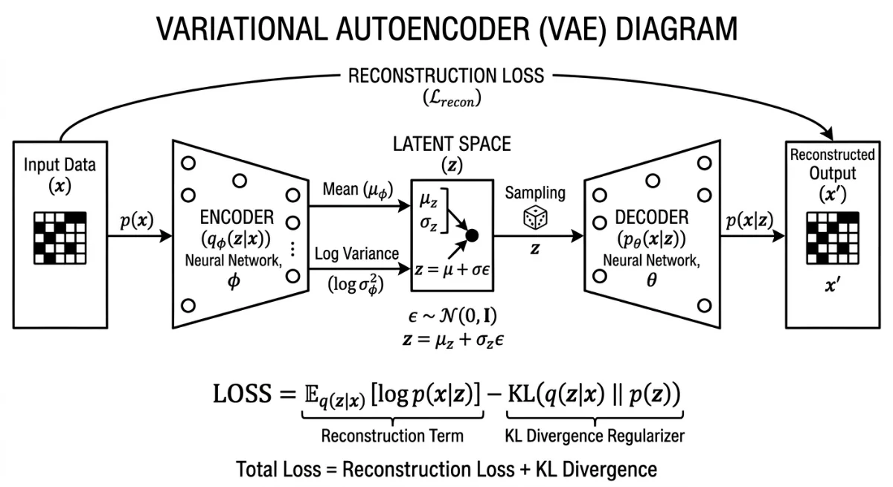
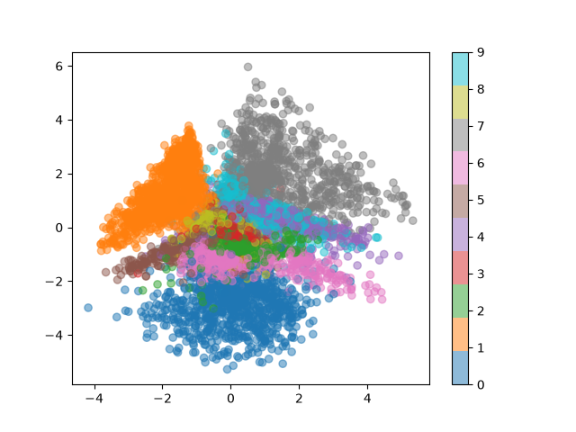

# Understanding the Variational Autoencoder

This document explains the ideas behind the VAE and maps each one to the code in this folder.

## 1. Motivation

A regular **autoencoder** compresses an input `x` into a code `z` and reconstructs it. It learns a good compression, but its latent space has no guaranteed structure: points between codes may decode into garbage, so you can't reliably *generate* new data by picking a random `z`.

A **Variational Autoencoder** fixes this by making the latent space probabilistic and regularised:

- The encoder doesn't output a single point. It outputs a **distribution** over `z` for each input.
- A penalty keeps these distributions close to a simple prior, `N(0, I)`.

The result is a smooth, continuous latent space where you can sample, interpolate, and decode.

## 2. The probabilistic model

The diagram below summarises the whole pipeline. The encoder maps the input `x` to a mean and a log-variance, a latent `z` is sampled with the reparameterisation trick, and the decoder reconstructs `x'` from `z`. Training combines a reconstruction loss with a KL regulariser.



> **Note on the loss in the diagram:** the formula `E[log p(x|z)] − KL(q‖p)` is the ELBO, which is *maximised*. In code we minimise its negative, so the reconstruction term becomes a BCE loss and the KL term is added (`Total Loss = Reconstruction Loss + KL Divergence`), as the bottom line of the diagram says. Both describe the same objective.

We assume data is generated by:

1. Sample a latent `z ~ p(z) = N(0, I)`
2. Sample `x ~ p_θ(x | z)` (the **decoder**)

We want to maximise `log p_θ(x)`, but the true posterior `p_θ(z | x)` is intractable. So we introduce an approximate posterior `q_φ(z | x)` (the **encoder**), a diagonal Gaussian:

$$q_\phi(z \mid x) = \mathcal{N}\big(z;\ \mu_\phi(x),\ \text{diag}(\sigma_\phi^2(x))\big)$$

## 3. The ELBO (the training objective)

Instead of `log p(x)`, we maximise a lower bound on it, the **Evidence Lower Bound**:

$$\log p_\theta(x) \ \ge\ \underbrace{\mathbb{E}_{q_\phi(z|x)}\big[\log p_\theta(x \mid z)\big]}_{\text{reconstruction}} \ -\ \underbrace{D_{KL}\big(q_\phi(z \mid x)\ \|\ p(z)\big)}_{\text{regularisation}}$$

Training minimises the negative ELBO:

$$\mathcal{L} = \underbrace{-\mathbb{E}_{q}\big[\log p_\theta(x \mid z)\big]}_{\text{reconstruction loss}} + \underbrace{D_{KL}\big(q_\phi(z \mid x)\ \|\ \mathcal{N}(0, I)\big)}_{\text{KL loss}}$$

The two terms pull in opposite directions:

- **Reconstruction** wants each input to get a precise, distinct code (so it can be rebuilt well).
- **KL** wants every code distribution to look like `N(0, I)` (so the latent space stays smooth and overlapping).

The balance between them is what makes a VAE both a good compressor and a good generator.

### Reconstruction term

MNIST pixels are in `[0, 1]`, so each pixel is modelled as a Bernoulli variable and the reconstruction loss is **binary cross-entropy**, summed over all pixels:

$$-\log p_\theta(x \mid z) = -\sum_i \big[x_i \log \hat{x}_i + (1 - x_i)\log(1 - \hat{x}_i)\big]$$

### KL term (closed form)

Because both `q` and the prior are Gaussians, the KL has a closed form, so no sampling is needed for it:

$$D_{KL} = -\frac{1}{2}\sum_{j=1}^{d}\big(1 + \log\sigma_j^2 - \mu_j^2 - \sigma_j^2\big)$$

## 4. The reparameterisation trick

The ELBO needs an expectation over `z ~ q(z | x)`. Sampling is a random operation, and gradients can't flow through it. The trick is to move the randomness into an input that doesn't depend on the parameters:

$$z = \mu + \sigma \odot \epsilon,\qquad \epsilon \sim \mathcal{N}(0, I)$$

Now `z` is a deterministic, differentiable function of `μ` and `σ`, and the noise `ε` is just an external input. Backpropagation reaches the encoder.

The network predicts **`logvar = log σ²`** rather than `σ` directly. This keeps the output unconstrained (any real number is valid), improves numerical stability, and makes `σ = exp(0.5 · logvar)` always positive.

## 5. Code walkthrough

### `get_data.py`: data

Loads MNIST with `ToTensor()` (pixels in `[0, 1]`) and returns the datasets and dataloaders (batch size 16; the train loader shuffles).

### `vae_model.py`: the model

**`Encoder`**: flattens the `28×28` image to 784 values, passes it through two ReLU layers (`784 → 512 → 256`), then two separate linear heads produce `mu` and `logvar`, each of size `latent_dim`.

**`reparameterise(mu, logvar)`**: implements `z = μ + σ · ε`:

```python
std = torch.exp(0.5 * logvar)
eps = torch.randn_like(std)
return mu + std * eps
```

**`Decoder`**: maps `z` back through `latent_dim → 256 → 512 → 784`. The final **sigmoid** forces outputs into `[0, 1]`, matching both the pixel range and the Bernoulli/BCE assumption. The output is reshaped to `(B, 1, 28, 28)`.

**`VAE`**: `encode → reparameterise → decode`, returning the reconstruction plus `mu` and `logvar` (which the loss needs).

### `train.py`: training and analysis

**`loss_function`** is the negative ELBO:

```python
recon_loss = F.binary_cross_entropy(recon_x, x, reduction='sum')
kl_div = -0.5 * torch.sum(1 + logvar - mu.pow(2) - logvar.exp())
return recon_loss + kl_div
```

Both terms use `sum`, so they stay on the same scale as in the ELBO. Using `mean` for one and `sum` for the other would silently change the weighting between reconstruction and KL. The `clamp` calls keep values in the valid range for BCE and avoid `log(0)`.

**`train`** is a standard loop. It computes the loss over the batch, backpropagates, and steps Adam. It reports the average loss **per training image** (total loss divided by dataset size).

**`generate_images`** samples `z ~ N(0, I)` and runs only the decoder. This is the generative use of a VAE, and it works precisely because the KL term made the latent space look like the prior.

**`visualise_latent_space`** encodes the test set and scatter-plots the 2-D codes coloured by digit label. Labels are used only for colouring, never for training.

**`interpolate_images`** encodes two digits to `z₁` and `z₂`, then decodes 10 points on the line between them:

$$z(\alpha) = (1-\alpha)\,z_1 + \alpha\,z_2,\quad \alpha \in [0, 1]$$

A smooth morph from one digit to the other shows that the latent space is continuous.

## 6. Reading the latent space plot



- **Clusters appear without labels.** The model was never told which digit is which, but images that look alike are encoded close together.
- **The distribution is centred around the origin** with a roughly unit-scale spread. That's the KL term at work, and it's why decoding random `N(0, I)` samples gives sensible digits.
- **Some classes are tight and distinct** (like `1`), while others **overlap** (like `4/9` and `3/5/8`). With only two latent dimensions, there simply isn't room to separate every class, and these digits genuinely look alike.
- **Few empty gaps**: neighbouring regions blend into each other, which is what makes interpolation smooth.

## 7. Implementation notes and possible extensions

Things worth knowing about this implementation:

- **`Normalize((0,), (1,))` is an identity transform** (`(x − 0) / 1`). It's harmless, and the data stays in `[0, 1]`, which is what the BCE loss requires. Don't switch to mean/std normalisation without also changing the loss.
- **The latent plot uses a sampled `z`**, not `mu`. Plotting `mu` gives the cleaner, deterministic "centre" of each encoding; plotting `z` shows the noise the decoder actually sees.
- **`epochs` defaults to 1** in `train()`, and `main()` doesn't override it. Increase it for better reconstructions and sharper clusters.
- **`train()` doesn't evaluate on the test set** each epoch. Tracking test loss would help spot overfitting.

Natural next steps:

- **Convolutional VAE** for sharper images and larger inputs
- **β-VAE**: weight the KL term (`recon + β · KL`) to trade reconstruction quality for a more disentangled latent space
- **Conditional VAE (CVAE)**: feed the label to both encoder and decoder to control which digit is generated
- **Larger latent dimension** (e.g. 16–32) with t-SNE/UMAP for visualisation, giving better reconstructions at the cost of direct plotting
- **Move to CelebA or CIFAR-10** with a conv architecture, then toward VQ-VAE and latent diffusion

## References

- D. P. Kingma and M. Welling, *Auto-Encoding Variational Bayes*, 2013. [arXiv:1312.6114](https://arxiv.org/abs/1312.6114)
- C. Doersch, *Tutorial on Variational Autoencoders*, 2016. [arXiv:1606.05908](https://arxiv.org/abs/1606.05908)
