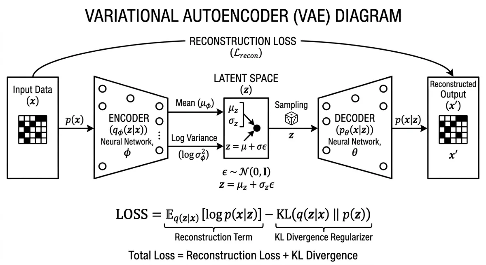
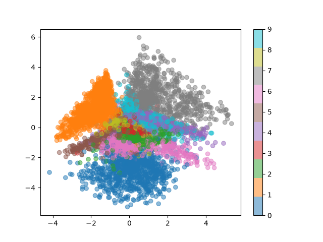

# Variational Autoencoder (VAE) in PyTorch

A from-scratch implementation of the Variational Autoencoder from **"Auto-Encoding Variational Bayes"** (Kingma & Welling, 2013) [[arXiv:1312.6114](https://arxiv.org/abs/1312.6114)], trained on MNIST with a **2-D latent space** so the learned representation can be plotted and explored directly.

For the theory and a walkthrough of the code, see [EXPLANATION.md](EXPLANATION.md).

## What's inside

| Feature | Where |
|---|---|
| MLP encoder that outputs `mu` and `logvar` | `vae_model.py` |
| Reparameterization trick | `vae_model.py` → `reparameterise` |
| MLP decoder with sigmoid output | `vae_model.py` |
| ELBO loss (BCE reconstruction + KL divergence) | `train.py` → `loss_function` |
| Sampling new digits from the prior | `train.py` → `generate_images` |
| Latent space visualisation | `train.py` → `visualise_latent_space` |
| Latent interpolation between two digits | `train.py` → `interpolate_images` |

## Project structure

```
vae/
├── get_data.py      # MNIST datasets and dataloaders
├── vae_model.py     # Encoder, Decoder, VAE, reparameterisation
├── train.py         # Loss, training loop, and visualisations
├── assets/
│   └── arch.png     # Overview diagram of the VAE
├── latent_space.png # Latent space of the test set, coloured by digit
├── EXPLANATION.md   # Theory + code walkthrough
└── README.md
```

## Architecture



The diagram shows the general VAE structure; below is the exact network used in this repo.

```
Encoder:  784 → 512 → 256 ─┬→ mu     (latent_dim)
                           └→ logvar (latent_dim)

z = mu + exp(0.5 * logvar) * eps,   eps ~ N(0, I)

Decoder:  latent_dim → 256 → 512 → 784 → sigmoid → reshape to (1, 28, 28)
```

## Setup

```bash
pip install torch torchvision matplotlib numpy
```

MNIST is downloaded automatically into `./data` on the first run.

## Usage

```bash
python train.py
```

This will:

1. Download MNIST and build the dataloaders
2. Train the VAE (Adam, lr = 1e-3, batch size = 16)
3. Show digits generated from random latent samples `z ~ N(0, I)`
4. Show the 2-D latent space of the test set, coloured by digit label
5. Show an interpolation between two test digits

### Configuration

| Setting | Location | Default |
|---|---|---|
| Latent dimension | `VAE(latent_dim=...)` in `train.py` | `2` |
| Epochs | `train(..., epochs=...)` | `1` |
| Learning rate | `optim.Adam(..., lr=...)` | `1e-3` |
| Batch size | `DataLoader(batch_size=...)` in `get_data.py` | `16` |

> The plotting functions assume `latent_dim=2` (the latent scatter plot uses two axes, and `generate_images` samples 2-D noise). If you change the latent size, update those too.

## Results

### Latent space

Each point is a test image encoded into the 2-D latent space, coloured by its digit class.



Even though the VAE never sees the labels, digits form clear regions. Digit **1** is a tight, compact cluster, **0** and **7** sit in well-separated regions, and visually similar digits (such as **4 / 9** and **3 / 5 / 8**) overlap in the middle. The whole distribution is centred near the origin, which is what the KL term pushes towards, so sampling from `N(0, I)` produces plausible digits.

## Reference

- D. P. Kingma and M. Welling, *Auto-Encoding Variational Bayes*, ICLR 2014. [arXiv:1312.6114](https://arxiv.org/abs/1312.6114)
